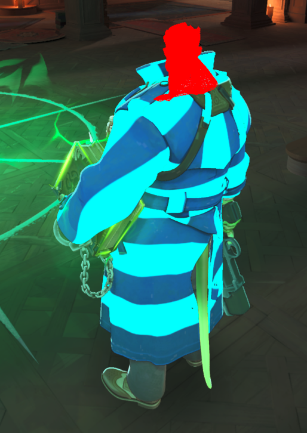
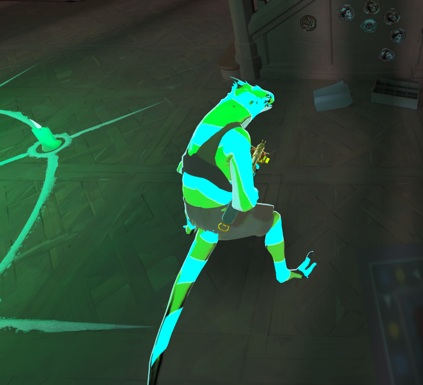
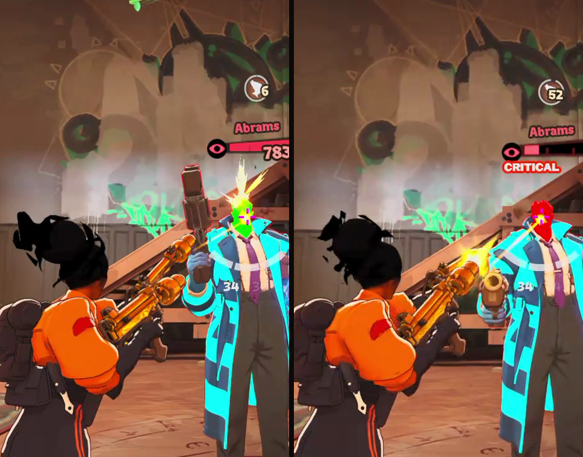
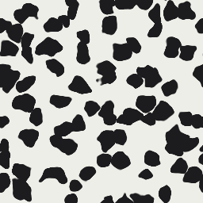
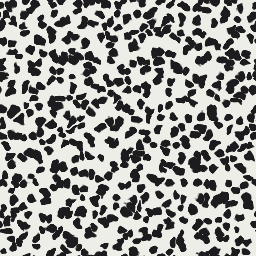

# Skin editing exports

The skin editor needs consistent results across the generated texture, model preview and game package. These commands preserve source texture formats, dimensions, mip chains and unrelated packed channels.

## Surface finish and translucency

`workshop finish` writes roughness to the packed normal/roughness channel and metalness to the material's actual metalness source. It preserves opacity on blended materials. Cloned textures receive lowercase paths and valid resource references.

`workshop surface --mode translucent --opacity 0.35` converts a supported static PBR material to ordinary alpha translucency. Opaque color alpha can store metalness. Conversion keeps it only when the material already binds a `g_tMetalness` slot; otherwise the see-through part loses its metalness, because adding a slot breaks the material in game (see below). This composes with pattern and tint edits before the finish pass. Cutout and dynamically controlled transparency materials are rejected.

The CLI also contains a Ghost recipe for research. It is experimental: it inserts a `g_tAltTranslucency` slot, which renders as a red wireframe in game. It is not a supported editor preset. Glass and sheen remain separate research candidates.

## Material edits never re-encode

The game renders a `.vmat_c` re-encoded from scratch as a red wireframe. In-game evidence: Abrams' head after a glow edit and Apollo's translucent sword, both of which store self-illumination values as tagless KV3 scalars (an exact 0 or 1 with no data bytes, so there is nothing to patch in place), plus the earlier soul-container probes. Values patched in place and parameters inserted next to existing ones load fine.

So `patch_vmat_params` never re-encodes. A float or vector that cannot change in place becomes a constant dynamic expression (`m_dynamicParams`, the way shipped animated materials drive values), which overrides the stored value. An int (a static combo flag) or attribute that cannot change in place fails with an error instead of producing a broken material. Workshop edits also never add a texture slot: binding a slot the material does not have forces the same re-encode.

## Areas of a part

Every texture-side edit takes an optional `--mask <PNG>`: a white-on-black UV mask, resized to the texture, that limits the edit to an area of the part. Grimoire bakes these from the areas painted on the model.

- `trippy-skin --material ... --mask`: color, pattern and adjustments blend into the isolated color texture inside the mask; alpha is kept.
- `workshop finish --mask`: roughness (normal map blue) and metalness (color alpha or the metalness mask) blend toward the finish inside the mask. Material constants stay. A small default mask texture is upscaled to the color texture's size first so the area has texels to land in.
- `workshop surface --mode translucent --mask`: color alpha becomes the area's opacity inside the mask and stays solid outside; the material's opacity scale is untouched.
- `workshop glow [--mask] --color RRGGBB --strength N --animation steady|pulse|rainbow --speed X [--paint-colors]`: turns on self-illumination with the mask (whole part without one) bound into the material's existing `g_tSelfIllumMask` slot. Pulse and rainbow are dynamic expressions on `g_flSelfIllumScale1` and `g_vSelfIllumTint1`; `--paint-colors` sets the albedo factor so the part glows in its own texture colors. A material has one glow color, so a part has one glow. Verified in game on parts that never shipped glow (Abrams' coat, Vyper's body).

Glow expressions can also read the hero: `$ent_health` is the health fraction (0 to 1). A head glow set to `$ent_health < 0.5 ? float3(1, 0, 0) : float3(0, 1, 0)` stayed green at full health and turned red below half in game.

## Moo and density

`trippy-skin --style moo --scale 1.5` and `trippy-preview --style moo --scale 1.5` use the same procedural cow-print sampler. Moo has smaller asymmetric patches, narrow white gaps and antialiasing tied to output resolution. Custom palettes retain their two-to-four color roles.

`trippy-skin --material ... --repaint ffffff` paints the entire color texture. Light and dark detail is kept relative to the painted texels' mean luminance, so the part averages to the picked color even on a dark texture (Grimoire's preview uses the same formula). It preserves packed alpha and neutralizes the material tint. Color-only edits leave existing scroll and lighting parameters intact. Repaint does not use the material's tint mask.

Scale ranges from 0.25 to 8. For Moo, it selects a whole periodic cell density based on nine cells per axis at 1x. Rounding density keeps fractional UI values seamless. Other pattern styles ignore this control and keep their previous output. Omitting Scale preserves the default value of 1. Texture scrolling remains a separate operation; this does not add gameplay-reactive animation.

## Model forms

Model export accepts explicit mesh group, material group and material override selections. The default model decoder still excludes alternate geometry; explicit variants opt in to it. Preview and inspection use the same material-slot and mesh-group mapping. This supports separate transformed models and authored body groups without changing the installed player model.

The app currently exposes the forms verified in-game: Silver werewolf, Calico cat, Viscous Goo Ball/Cube and Ivy Stone Form. Shiv and Yamato authored variants remain excluded until their gameplay resource routes and status effects are understood.

## Other corrections

Pattern exports preserve native texture packing and insert runtime scroll parameters when absent. Palette previews and baked tiles share the same color mapping. Movement-effect recoloring includes the top-level heavy-melee particle so its root layer is not left at the original color.

Native tests cover source preservation, texture layouts and packed-channel handling, resource-string flags and references, model variants, pattern preview/export parity, and seamless Moo generation. Successful decoding alone does not establish in-game shader behavior.
